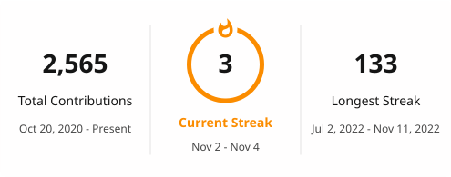

<h1 align="center">Hi, I'm Vitalik-Hakim 👋</h1>

  <b>Software engineer · open-source maintainer · founder of <a href="https://antigpt.app">AntiGPT</a></b> 
  Computer Science at Ashesi University

  

  
  
  
  
  
  
  

## About me

- 🔧 **Open source:** reviving [pysftp](https://pypi.org/project/pysftp/), still installed about 11.8 million times a month but broken on paramiko 4, as **[pysftp-ng](https://github.com/Vitalik-Hakim/pysftp-ng)**: a drop-in fork tested on Python 3.9–3.14.
- 🚀 **Founder and sole engineer of [AntiGPT](https://antigpt.app):** a paid SaaS that refines AI-written text, grown to 10,000+ users. I run it end to end: backend, frontend, billing and infrastructure.
- 🎓 **Computer Science at Ashesi University** (class of 2028). 
- 💼 **Open to** software engineering internships and roles.

## Featured work

| Project | What it is |
| --- | --- |
| [**pysftp-ng**](https://github.com/Vitalik-Hakim/pysftp-ng) | Maintained, drop-in fork of pysftp: paramiko 4/5 support, Ed25519 keys, host-key and Windows path fixes |
| [**AntiGPT**](https://antigpt.app) | Paid SaaS that refines AI-generated text for readability and accuracy, with 10,000+ users |
| [**Antimony**](https://github.com/Vitalik-Hakim/antimony) | Peer-to-peer electronic cash system in C++ (daemon and Qt GUI): P2P networking, Scrypt proof-of-work, built-in miner, wallet and testnet |
| [**PytoExe**](https://github.com/Vitalik-Hakim/pytoexe-deploy) | Web app that turns Python scripts into `.exe` files through a first-in, first-out job queue |

## Open-source contributions

- **[Gitian Builder](https://github.com/devrandom/gitian-builder)**, Bitcoin Core's former deterministic build system: two merged fixes ([f07a095](https://github.com/devrandom/gitian-builder/commit/f07a0951d7bae8ebf4b6f37c2664bdb05ebbb4cc), [e2c4195](https://github.com/devrandom/gitian-builder/commit/e2c4195ffce85a2d2bf32a9c9e5f9750cc7651ee)) that restored builds broken when Ubuntu moved its old releases.
- **[Turborepo](https://github.com/vercel/turborepo)**: [documentation contribution](https://github.com/vercel/turborepo/commits?author=Vitalik-Hakim).
- **[NVIDIA garak](https://github.com/NVIDIA/garak)**, an LLM vulnerability scanner: [pull requests](https://github.com/NVIDIA/garak/pulls?q=is%3Apr+author%3AVitalik-Hakim).

## Tech stack

| Area | Tools |
| --- | --- |
| Languages | Python · TypeScript/JavaScript · C++ · PHP · Lua · Bash |
| Web and mobile | Next.js (T3: tRPC, Prisma) · React Native (Expo) · Django · FastAPI · Laravel · Vue |
| Data | PostgreSQL · MySQL · SQLite · MongoDB · Supabase · Firebase · LevelDB |
| Infrastructure | Linux · Docker · GitHub Actions · AWS · DigitalOcean |
| Blockchain | Layer-1 protocol development · Solidity · Web3 |
| Security | CTF: web, crypto, forensics |

## GitHub stats

  <picture>
    <source media="(prefers-color-scheme: dark)" srcset="./profile/stats-dark.svg">
    
  </picture>
  <picture>
    <source media="(prefers-color-scheme: dark)" srcset="./profile/top-langs-dark.svg">
    
  </picture>

  <picture>
    <source media="(prefers-color-scheme: dark)" srcset="./profile/streak-dark.svg">
    
  </picture>

Cards refresh daily. Top languages reflect public code only, not skill level.

<!--  Happy birthday to myself -->
<!-- Easter egg: check the commit date -->

Thanks for stopping by! ❤️

